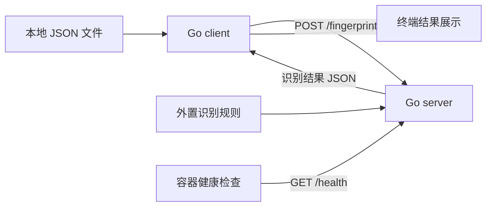

# Banner 指纹识别系统技术设计

## 1. 产品目标

使用 Go 开发一个可演示的 Banner 指纹识别产品，将网络扫描数据中的 `ip`、`port`、`banner` 转换为协议、软件、版本、操作系统线索和置信度。

产品以一次完整的批量识别为交付闭环：

**本地 JSON 文件 → client 读取并发送 → server 识别 → 返回结果 → client 展示。**

演示覆盖 SSH、HTTP、MySQL、Redis、FTP 五类协议，以及 OpenSSH、nginx、Apache、Jetty、MySQL、Redis、ProFTPD 等软件。输入、服务接口、结果展示和容器启动共同构成验收范围。

本文定义开发方案与演示验收标准，实现状态以提交仓库中的代码和实际运行结果为准。

## 2. 演示方式

评估者克隆仓库后，在项目目录执行：

```sh
docker compose up
```

Compose 构建并启动 server，健康检查通过后启动 client。client 读取项目自带的样例文件，提交批量识别请求，在终端展示结果，然后正常退出。server 持续运行，可接受后续识别请求。

使用另一份输入文件时，将文件放入 `samples/` 目录，并执行：

```sh
docker compose run --rm client --server http://server:8080 --input /data/input.json
```

结果采用格式化 JSON 展示，字段和 API 响应保持一致，方便直接查看与核对。

## 3. 系统架构



| 模块 | 职责 |
| --- | --- |
| client | 读取本地文件、发送 HTTP 请求、展示识别结果 |
| server | 提供批量识别与健康检查接口 |
| 识别引擎 | 判断协议、匹配产品、提取版本和操作系统线索 |
| 规则文件 | 保存软件特征、提取表达式、产品名称与置信度 |
| Docker Compose | 构建镜像、启动服务、组织网络与健康依赖 |

系统使用 Go 标准库完成 HTTP、JSON 和正则处理。规则从独立 JSON 文件加载，识别过程直接分析传入的 Banner。

## 4. 输入与输出

### 4.1 输入结构

client 读取的文件与 server 请求体采用相同结构：

```json
[
  {
    "ip": "1.2.3.4",
    "port": 22,
    "banner": "SSH-2.0-OpenSSH_8.9p1 Ubuntu-3"
  },
  {
    "ip": "1.2.3.5",
    "port": 80,
    "banner": "HTTP/1.1 200 OK\r\nServer: nginx/1.24.0\r\nContent-Type: text/html"
  }
]
```

| 字段 | 类型 | 含义 |
| --- | --- | --- |
| `ip` | string | 扫描目标地址 |
| `port` | integer | 扫描目标端口 |
| `banner` | string | 扫描采集到的响应内容 |

演示文件使用标准 JSON。题目中的重复双引号应还原为正常字段语法，字节展示中的 `\x00` 应转换为 JSON 支持的 `\u0000`。[JSON 字符串转义规范](https://www.rfc-editor.org/rfc/rfc8259.html#section-7)

MySQL 自测数据表示为：

```json
{"ip":"1.2.3.7","port":3306,"banner":"J\u0000\u0000\u0000\n8.0.32\u0000"}
```

该样例中的 NUL 与换行在 JSON 解码后恢复为对应字符，供识别引擎读取。

### 4.2 输出结构

每条输入对应一条结果，顺序保持一致，固定包含以下七个字段：

| 字段 | 类型 | 含义 |
| --- | --- | --- |
| `ip` | string | 原输入地址 |
| `port` | integer | 原输入端口 |
| `protocol` | string | SSH、HTTP、MySQL、Redis、FTP 或 `unknown` |
| `product` | string | 软件名称 |
| `version` | string | 软件版本 |
| `os_hint` | string | 操作系统线索 |
| `confidence` | number | 规则置信度，范围为 `0` 至 `1` |

没有版本或操作系统线索时，相应字段为空字符串。未命中识别规则时返回：

```json
{"ip":"1.2.3.23","port":12345,"protocol":"unknown","product":"","version":"","os_hint":"","confidence":0}
```

`unknown` 是正常结果，批次继续处理。置信度采用规则配置值，表达识别证据的强弱。

## 5. 接口设计

### 5.1 批量识别

**`POST /fingerprint`**

请求头：`Content-Type: application/json`。

请求体：扫描记录 JSON 数组。

成功响应：`200 OK`，响应体为识别结果 JSON 数组。

```json
[
  {"ip":"1.2.3.4","port":22,"protocol":"SSH","product":"OpenSSH","version":"8.9p1","os_hint":"Ubuntu","confidence":0.95},
  {"ip":"1.2.3.5","port":80,"protocol":"HTTP","product":"nginx","version":"1.24.0","os_hint":"","confidence":0.9}
]
```

输入文件或请求体无法解析为规定结构时，返回 `400` 和简洁错误消息：

```json
{"error":"invalid input JSON"}
```

### 5.2 健康检查

**`GET /health`**

server 成功加载规则并可以处理请求时，返回 `200 OK`：

```json
{"status":"ok"}
```

规则加载成功后再启动 HTTP 服务，健康接口因此对应可使用的识别引擎。规则文件读取或编译失败时，server 输出明确错误并退出。

## 6. 指纹识别方案

### 6.1 处理流程

1. 为当前输入建立默认 `unknown` 结果。
2. 根据 Banner 特征判断协议。
3. 匹配该协议的软件规则，提取版本。
4. 从明确的软件标识或注释中提取操作系统线索。
5. 填入规则置信度，返回结果。

识别依据来自 Banner。端口作为原始信息保留，因此 `443` 或 `8080` 上的 HTTP 响应仍输出 `HTTP`。

### 6.2 协议与软件规则

| 协议 | 识别依据 | 提取内容 |
| --- | --- | --- |
| SSH | `SSH-2.0-OpenSSH_` 或 `SSH-1.99-OpenSSH_` 标识 | OpenSSH 版本，Ubuntu、Debian 等明确标记 |
| HTTP | HTTP 响应状态行及 `Server` 头 | nginx、Apache、Jetty 的名称与版本 |
| MySQL | 握手前缀中的协议字节及 NUL 结束的版本串 | MySQL 版本 |
| Redis | `+PONG`、特定命令错误、`-NOAUTH Authentication required.` | Redis 产品；响应未提供版本时留空 |
| FTP | 欢迎行中的 `ProFTPD` 软件标记 | ProFTPD 版本 |

HTTP 软件规则分别提取 `nginx/1.24.0`、`Apache/2.4.57`、`Jetty/9.4.51` 等形式中的版本。

MySQL 自测样例虽然只保留握手前缀，但已经包含协议字节和完整版本字段，足以提取 `8.0.32`。实现使用简短的前缀解析读取可见版本。[MySQL HandshakeV10 格式](https://dev.mysql.com/doc/dev/mysql-server/latest/page_protocol_connection_phase_packets_protocol_handshake_v10.html)

版本从输入中提取，规则覆盖对应的版本格式，保证更换版本号后仍能产生结果。

### 6.3 规则文件

规则存放在 `rules/fingerprints.json`，server 启动时读取。协议字段定位由识别引擎负责，产品匹配、版本表达式、操作系统标记和置信度由配置负责。

规则示例：

```json
{
  "rules": [
    {
      "id": "http.nginx",
      "protocol": "HTTP",
      "product": "nginx",
      "pattern": "(?im)^Server:[ \\t]*nginx/(?P<version>[0-9.]+)",
      "version_group": "version",
      "confidence": 0.9
    }
  ],
  "os_hints": [
    {"pattern": "Ubuntu", "value": "Ubuntu"},
    {"pattern": "Debian", "value": "Debian"}
  ]
}
```

文本表达式使用 Go `regexp`，在启动时编译。配置中保存产品名称与字段映射，识别代码负责统一执行规则。新增已有协议下的软件规则后，重启 server 即可生效。[Go regexp 官方文档](https://pkg.go.dev/regexp)

## 7. client 设计

client 提供以下参数：

| 参数 | 示例 | 含义 |
| --- | --- | --- |
| `--input` | `/data/samples.json` | 本地输入文件 |
| `--server` | `http://server:8080` | server 地址 |

client 的执行步骤为读取文件、解析 JSON、请求 `/fingerprint`、读取响应、输出格式化 JSON。成功时退出码为 `0`；文件读取、请求或响应失败时，向标准错误输出原因并以非零状态退出。

client 使用明确的 HTTP 请求超时，例如 `30s`，确保演示中的连接失败能够及时反馈。

## 8. 容器部署设计

### 8.1 镜像构建

Dockerfile 使用多阶段构建：构建阶段编译两个 Go 程序，运行阶段分别生成 `server-runtime` 与 `client-runtime` 镜像目标。运行镜像包含所需程序与配置，采用 `CGO_ENABLED=0` 编译静态 Linux 二进制。[Docker 多阶段构建文档](https://docs.docker.com/build/building/multi-stage/)

运行镜像使用固定非 root 用户。健康探针由 server 的 `--healthcheck` 模式实现，实际调用 `/health` 并以退出码表示检查结果。

### 8.2 网络与启动依赖

server、client 连接同一个专用容器网络。client 通过 `http://server:8080` 访问 server，默认部署的 API 入口保留在该网络内。[Docker Compose 网络文档](https://docs.docker.com/compose/how-tos/networking/)

client 通过 `depends_on: condition: service_healthy` 等待 server 的实际健康检查成功。[Docker Compose 启动依赖文档](https://docs.docker.com/compose/how-tos/startup-order/)

### 8.3 Compose 配置

以下配置对应本方案的镜像目标与程序参数：

```yaml
services:
  server:
    build:
      context: .
      target: server-runtime
    command: ["--listen", ":8080", "--rules", "/app/rules/fingerprints.json"]
    user: "65532:65532"
    read_only: true
    cap_drop: ["ALL"]
    security_opt: ["no-new-privileges:true"]
    restart: unless-stopped
    volumes:
      - ./rules:/app/rules:ro
    networks: [fingerprint]
    healthcheck:
      test: ["CMD", "/app/server", "--healthcheck"]
      interval: 5s
      timeout: 2s
      retries: 5

  client:
    build:
      context: .
      target: client-runtime
    command: ["--server", "http://server:8080", "--input", "/data/samples.json"]
    user: "65532:65532"
    read_only: true
    cap_drop: ["ALL"]
    security_opt: ["no-new-privileges:true"]
    restart: "no"
    depends_on:
      server:
        condition: service_healthy
    volumes:
      - ./samples:/data:ro
    networks: [fingerprint]

networks:
  fingerprint:
    internal: true
```

规则与样例目录按只读方式挂载。Dockerfile 的执行入口分别为 `/app/server`、`/app/client`，运行用户能够读取挂载文件。

## 9. 项目目录

```text
banner-fingerprint/
├── cmd/
│   ├── server/main.go
│   └── client/main.go
├── internal/
│   ├── api/
│   ├── fingerprint/
│   └── model/
├── rules/
│   └── fingerprints.json
├── samples/
│   ├── samples.json
│   └── expected.json
├── Dockerfile
├── compose.yaml
├── .dockerignore
├── go.mod
└── README.md
```

README 说明启动命令、输入格式、client 调用方法、API 示例、规则位置和实际测试结果。注释集中说明 MySQL 样例解析与规则字段提取等必要逻辑。

## 10. 演示验收

### 10.1 样例结果

演示使用题目中的七条基础数据，预期结果如下：

| IP | 端口 | 协议 | 软件 | 版本 | OS 线索 | 置信度 |
| --- | ---: | --- | --- | --- | --- | ---: |
| 1.2.3.4 | 22 | SSH | OpenSSH | 8.9p1 | Ubuntu | 0.95 |
| 1.2.3.5 | 80 | HTTP | nginx | 1.24.0 | | 0.90 |
| 1.2.3.6 | 443 | HTTP | Apache | 2.4.57 | | 0.90 |
| 1.2.3.7 | 3306 | MySQL | MySQL | 8.0.32 | | 0.90 |
| 1.2.3.8 | 6379 | Redis | Redis | | | 0.70 |
| 1.2.3.9 | 21 | FTP | ProFTPD | 1.3.7 | | 0.90 |
| 1.2.3.10 | 8080 | HTTP | Jetty | 9.4.51 | | 0.85 |

另加入 `QUIT\r\n` 样例，确认未识别内容返回 `unknown`，并且同一批次中的其他记录正常返回。

### 10.2 完成标准

1. 执行 `docker compose up` 可以完成构建与启动。
2. server 健康后，client 自动提交样例并展示识别结果。
3. 七条样例的协议、软件、版本、操作系统线索和置信度符合预期。
4. 未识别样例返回规定的 `unknown` 结果。
5. 替换样例中的版本号后，引擎仍能从 Banner 提取版本。
6. 更换输入文件后，独立 client 调用可以完成同样的识别闭环。

验证围绕规则提取、两个接口与一次 Compose 实际运行展开。测试命令包括 `go test ./...`，部署配置通过 `docker compose config` 检查。

## 11. 开发与交付安排

| 时间段 | 工作内容 |
| --- | --- |
| 0—5 分钟 | 创建项目、数据模型、接口与 client 基础流程 |
| 5—15 分钟 | 完成五类协议与外置产品规则，跑通样例 |
| 15—22 分钟 | 完成镜像、Compose、健康依赖和结果展示 |
| 22—27 分钟 | 验证闭环，整理 README、样例与预期结果 |
| 27—30 分钟 | 提交实际完成代码，确认仓库可访问并交付地址 |

所有开发、文件编辑、运行环境和 GitHub 操作通过 AI 编程工具执行，以提示词作为操作入口。开发过程按题目要求通过腾讯会议共享屏幕并全程录屏。

最终交付为可直接启动的项目仓库，包括源码、外置规则、Dockerfile、Compose 配置、自测输入、预期结果与 README。

仓库采用公开可访问方式，或提前向评估者账号授予克隆权限。收到题目后 30 分钟内提交当时的实际完成状态，反馈仓库地址及最终 commit 标识，以该提交作为验收版本。
